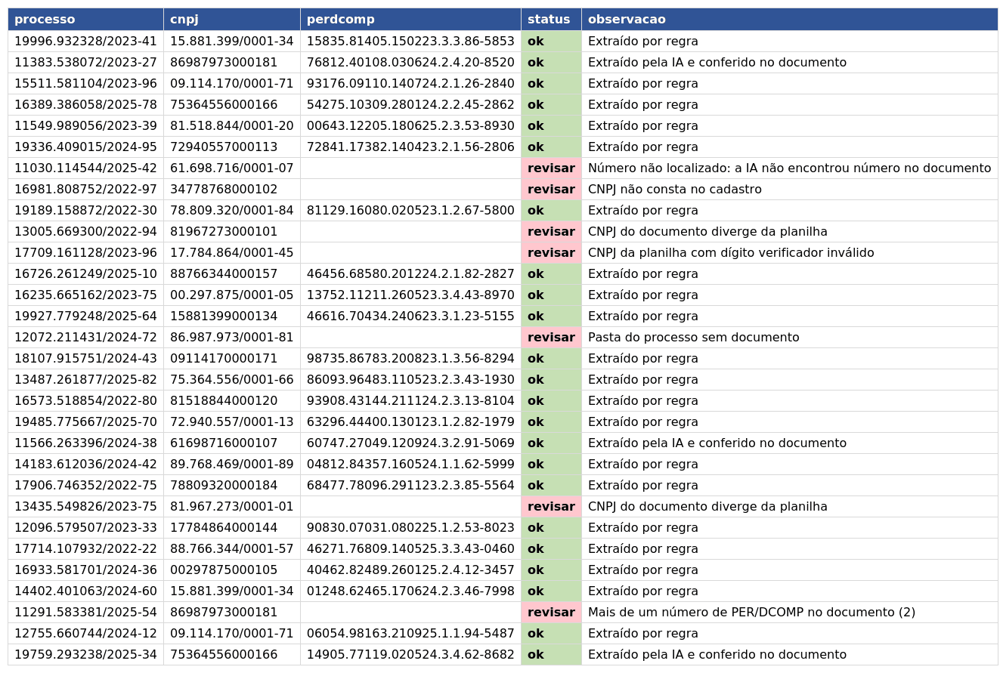
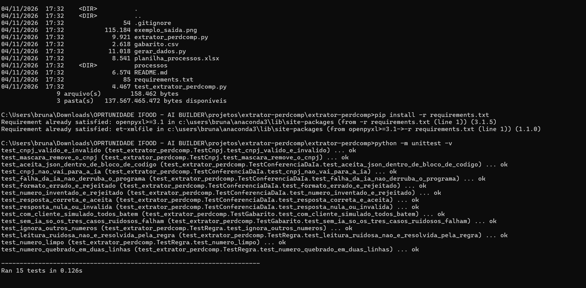
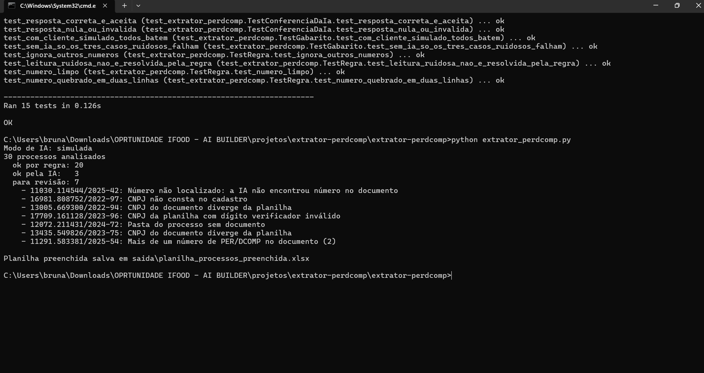

# Extrator de PER/DCOMP com IA

Programa em Python que preenche a planilha de processos com o **número do PER/DCOMP**, buscando-o no documento da pasta de cada processo e conferindo o CNPJ. Usa **regra primeiro, IA só quando o texto está sujo e conferência sempre**; o que gera dúvida vai para revisão humana, com o motivo.

Foi o meu primeiro projeto como estagiária e o meu primeiro contato com limpeza, extração e conferência de dados.

Com o tempo, várias pessoas passaram pela área e cada uma salvava o PER/DCOMP dos processos de um jeito. O resultado era uma pasta com milhares de arquivos espalhados, sem nenhum padrão de nome, onde achar o documento de um processo era uma caça ao tesouro.

Criei uma automação que localizava o documento e extraía o número. Levei dois meses e meio para colocá-la em funcionamento, e o maior desafio foram os arquivos que o robô não conseguia ler.

**Resultado: dos 438 processos, 415 foram resolvidos automaticamente e 23 (cerca de 5%) precisei validar à mão. Economizei cerca de duas semanas de busca manual.**

Este repositório reproduz a ideia com dados 100% fictícios, e acrescenta IA para os casos em que só a regra não basta.

> Projeto de portfólio com **dados 100% fictícios**. Reproduz, de forma limpa e segura, uma rotina de compliance fiscal que automatizei na prática.



## O problema

Achar à mão, dentro da pasta de cada processo, o número do PER/DCOMP certo e copiá-lo para a planilha é lento e sujeito a erro: documento de outra empresa, número quebrado em duas linhas, leitura ruim de documento digitalizado.

## Como funciona

Para cada linha da planilha:

1. **Valida o CNPJ** pelo dígito verificador e confere se ele consta no cadastro.
2. **Abre a pasta do processo** e lê o documento. Sem documento, vai para revisão.
3. **Confere o CNPJ do documento** com o da planilha, para não pegar o documento de outra empresa.
4. **Extrai o número por regra (regex)**, juntando números quebrados em duas linhas. Se achar mais de um número, vai para revisão.
5. **Se a regra não achar nada**, chama a IA para ler o texto sujo.
6. **Confere a resposta da IA por código**: o número precisa ter o formato certo e **existir no documento**. Se a IA inventar, o número é descartado.
7. **Grava na planilha** o número, o status (`ok` ou `revisar`) e a observação com o motivo.

A planilha original nunca é alterada: o resultado vai para `saida/planilha_processos_preenchida.xlsx`.

### Por que esse desenho

- **A regra resolve o que é previsível**, de graça e sem erro. A IA entra só no que a regra não cobre.
- **A IA propõe e o código decide.** Um modelo de linguagem pode errar ou inventar; por isso a resposta só vale se estiver no documento.
- **Na dúvida, um humano revisa**, e a planilha diz o porquê.
- **Privacidade:** só os documentos que a regra não resolveu vão para a IA, e o CNPJ é substituído por `[CNPJ]` antes do envio. A planilha nunca é enviada.

## Casos de teste incluídos

Os 30 processos fictícios incluem casos difíceis de propósito (resultado esperado em `gabarito.csv`):

| Caso | Qtd | Resultado esperado |
|---|---|---|
| Documento limpo (3 layouts) | 17 | número extraído por regra |
| Número quebrado em duas linhas | 3 | número extraído por regra |
| Leitura ruidosa (O no lugar de 0, l no lugar de 1, espaço no meio) | 3 | número extraído pela IA e conferido |
| CNPJ do documento diverge da planilha | 2 | revisar |
| Pasta sem documento | 1 | revisar |
| Dois números (original e retificadora) | 1 | revisar |
| Documento sem número | 1 | revisar |
| CNPJ da planilha com dígito verificador inválido | 1 | revisar |
| CNPJ fora do cadastro | 1 | revisar |

## Como rodar

Requer Python 3.9 ou superior.

```
pip install -r requirements.txt
python extrator_perdcomp.py
```

O modo padrão usa um **cliente simulado**, que **não é IA**: ele imita a resposta de um modelo para você testar todo o fluxo sem chave de API. Exemplo do resultado:

```
Modo de IA: simulada
30 processos analisados
  ok por regra: 20
  ok pela IA:   3
  para revisão: 7
    - 11030.114544/2025-42: Número não localizado: a IA não encontrou número no documento
    - 16981.808752/2022-97: CNPJ não consta no cadastro
    - 13005.669300/2022-94: CNPJ do documento diverge da planilha
    - 17709.161128/2023-96: CNPJ da planilha com dígito verificador inválido
    - 12072.211431/2024-72: Pasta do processo sem documento
    - 13435.549826/2023-75: CNPJ do documento diverge da planilha
    - 11291.583381/2025-54: Mais de um número de PER/DCOMP no documento (2)
```

Outros modos:

```
python extrator_perdcomp.py --ia nenhuma    # só regra, sem IA
python extrator_perdcomp.py --ia claude     # IA real (precisa de chave)
```

### IA real (Claude)

```
pip install anthropic
set ANTHROPIC_API_KEY=sua-chave        (Windows)
export ANTHROPIC_API_KEY=sua-chave     (Linux/Mac)
python extrator_perdcomp.py --ia claude
```

O modelo padrão é `claude-haiku-5-5` e pode ser trocado com a variável `CLAUDE_MODEL`. Nunca coloque a chave no código nem suba um arquivo `.env` ao GitHub. Se a chamada à IA falhar, o processo vai para revisão e o programa continua.

Para usar outro provedor, crie uma classe com o método `responder(texto)`, como `ClienteClaude` em `extrator_perdcomp.py`.

## Testes

```
python -m unittest -v
```

São 15 testes. Eles cobrem a validação de CNPJ, a extração por regra, o tratamento das respostas da IA (resposta correta, número inventado, formato errado, JSON inválido, falha na chamada, CNPJ mascarado) e a comparação dos 30 processos com o `gabarito.csv`. Com o cliente simulado, os 30 conferem; sem IA, 27 conferem e os 3 casos de leitura ruidosa vão para revisão.

## Estrutura do repositório

```
extrator-perdcomp/
├── extrator_perdcomp.py        # programa principal
├── test_extrator_perdcomp.py   # testes automatizados
├── gerar_dados.py              # gera os dados fictícios
├── planilha_processos.xlsx     # processos e cadastro de CNPJ (fictícios)
├── gabarito.csv                # resultado esperado, usado nos testes
├── processos/                  # uma pasta por processo, com o documento
├── exemplo_saida.png           # visualização da planilha de saída
└── requirements.txt
```

## Limitações e próximos passos

- O formato do número do PER/DCOMP é **ilustrativo**; ajuste `PADRAO_PERDCOMP` ao formato real.
- Os documentos são arquivos `.txt`. PDFs e documentos digitalizados exigiriam extração de texto e OCR antes.
- Os 30 casos são sintéticos. O desempenho com a IA real e com documentos reais precisa ser medido; os testes automatizados usam o cliente simulado e respostas ensaiadas.
- Para erros de leitura já conhecidos (O/0, l/1), uma regra determinística seria mais barata que a IA; a IA cobre os ruídos que não se previu. A conferência no documento vale nos dois casos.
- Ideia futura: lidar com documentos que tenham mais de um número, escolhendo pelo tipo (original ou retificadora).

## Como usei IA neste projeto

Eu defini o problema, o fluxo e as regras de conferência, vindos da rotina que automatizei na prática. O código foi escrito com apoio de IA (Claude) e validado por testes automatizados. Dentro do produto, a IA só lê texto sujo, e o código confere o resultado.

## Execução no terminal

Os 15 testes automatizados passando:



Execução do robô com os 30 processos:


